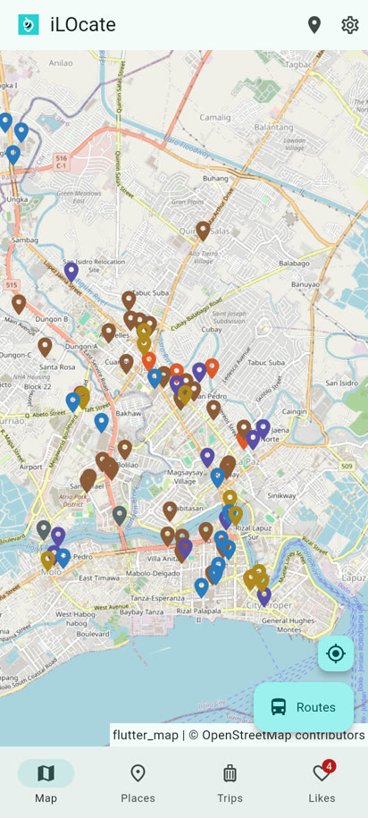
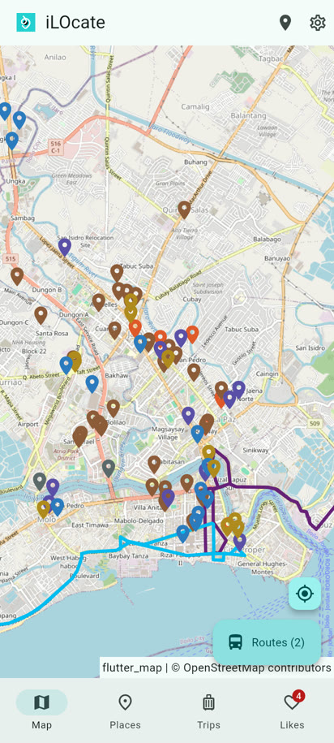
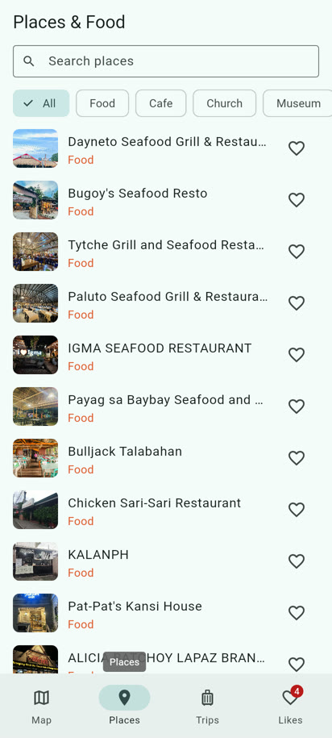
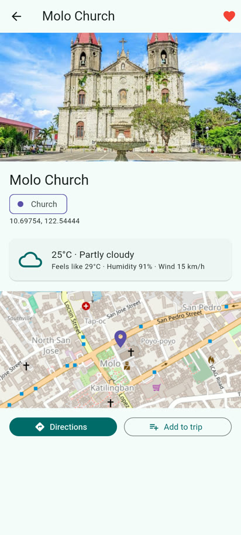
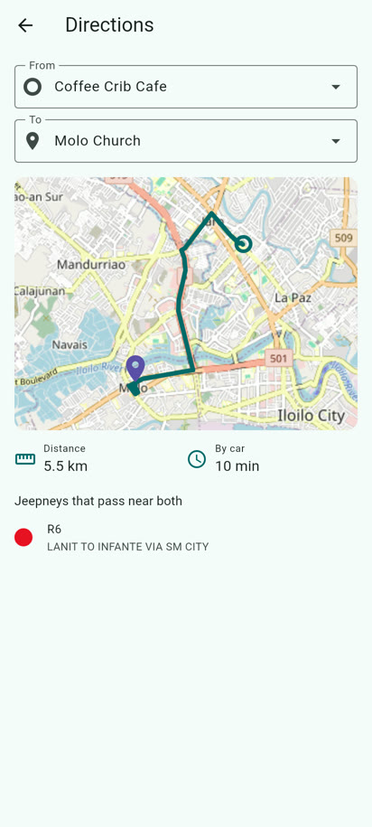
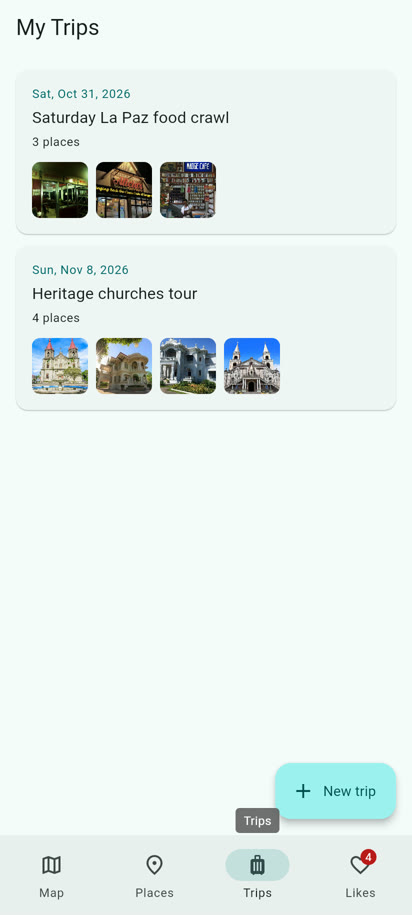
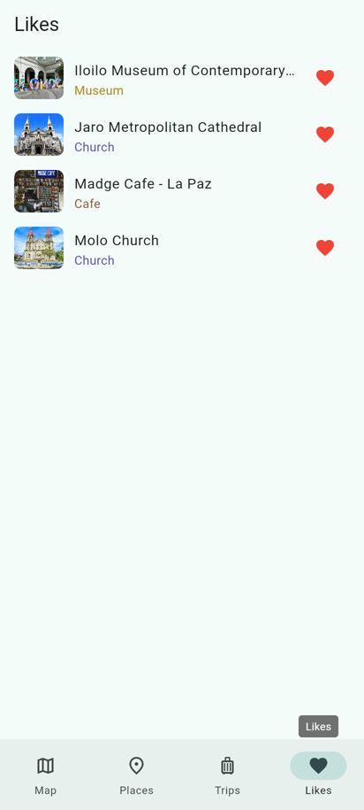
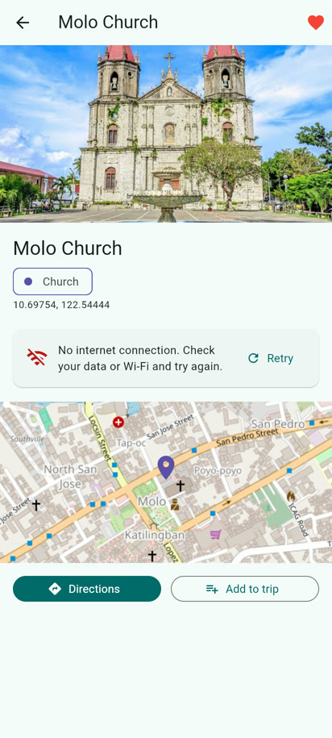

# iLOcate

iLOcate is a Flutter app for getting around Iloilo City. It puts the city's jeepney (PUJ) routes and 98 local landmarks, restaurants and cafes on one map. You can check the weather at a place, get road directions to it, find which jeepneys pass near both ends of the trip, and save trip plans on your phone.

**Course:** SE2142 Software Engineering Tools and Practices, Final Project
**Repository:** https://github.com/Reeiinn/iLOcate

## Team

| Member | GitHub | Role |
| --- | --- | --- |
| Reinwel G. Tingson | [@Reeiinn](https://github.com/Reeiinn) | Developer (UI, state management, API/data layer, testing, documentation, repo manager) |

## Screenshots

| Map | Jeepney routes | Places | Place details |
| --- | --- | --- | --- |
|  |  |  |  |

| Directions | Trips | Trip details | Trip form |
| --- | --- | --- | --- |
|  |  |  |  |

| Likes | Settings | Offline error | Empty state |
| --- | --- | --- | --- |
|  |  |  |  |

## Features

- **Map**: OpenStreetMap with 98 color-coded place pins. Tap a pin for a preview.
- **Jeepney routes**: draw any of the 27 PUJ routes on the map.
- **My location**: GPS button that centers the map on you and shows a blue dot.
- **Places & Food**: search by name and filter by category.
- **Place details**: photo, category, live weather (Open-Meteo) and a mini map.
- **Directions**: pick a start (a place or your GPS location) and a destination. The app draws the OSRM road route, shows distance and time, and lists the jeepneys that pass within 500 m of both ends.
- **Trips (CRUD)**: create, view, edit and delete trip plans with a date, notes and a list of stops. Swipe to delete with undo. Form validation on every field.
- **Likes**: heart places to save them. Likes stay after the app closes.
- **Settings**: light, dark or system theme, and clear likes.
- **Error handling**: loading spinners, offline and server error messages with Retry, and empty states on every list.

## Project structure

```
lib/
  main.dart              Provider setup
  app.dart               MaterialApp, themes, named routes
  models/                Place, PujRoute, Trip, Weather, DirectionsResult
  services/              ApiClient, WeatherService, DirectionsService,
                         LocationService, LocalStore, AssetDataService,
                         commute_planner
  providers/             PlacesProvider, LikesProvider, TripsProvider,
                         SettingsProvider, LocationProvider
  routes/app_router.dart Route names, argument classes, onGenerateRoute
  screens/               11 screens (home shell + 4 tabs, details, directions,
                         trip details, trip form, settings, not found)
  widgets/               Reusable widgets (PlaceTile, PlaceImage, LikeButton,
                         EmptyState, ErrorView, OsmTileLayer, TypeChip, ...)
  theme/app_theme.dart   Light/dark theme and place-type colors
test/                    Unit and widget tests (22 tests)
```

## APIs

| API | Endpoint | Used for |
| --- | --- | --- |
| Open-Meteo | `GET https://api.open-meteo.com/v1/forecast?latitude=..&longitude=..&current=...` | Weather card on place details |
| OSRM | `GET https://router.project-osrm.org/route/v1/driving/{lng},{lat};{lng},{lat}?overview=full&geometries=polyline6` | Directions screen |
| OpenStreetMap tiles | `https://tile.openstreetmap.org/{z}/{x}/{y}.png` | All maps |

Neither API needs a key.

## Packages

| Package | Version | Why |
| --- | --- | --- |
| provider | 6.1.5+1 | Shared app state (ChangeNotifier) |
| http | 1.6.0 | REST calls to Open-Meteo and OSRM |
| shared_preferences | 2.5.6 | Saves likes, trips and theme on the device |
| flutter_map | 8.3.2 | OpenStreetMap map widget |
| latlong2 | 0.9.1 | Coordinates and distance math |
| geolocator | 14.1.2 | GPS position and location permission |
| intl | 0.20.3 | Date formatting |
| flutter_launcher_icons | 0.14.4 (dev) | Generates the app icon |
| flutter_native_splash | 2.4.8 (dev) | Generates the splash screen |
| flutter_lints | 5.0.0 (dev) | Lint rules for `flutter analyze` |

## Setup and run

Requirements: Flutter 3.44 or newer (Dart 3.12), Android SDK with an emulator or a phone with USB debugging.

```bash
flutter pub get
flutter run
```

Maps, weather and directions need an internet connection. Places and jeepney routes are bundled, so they still load offline.

Check the code and run the tests:

```bash
flutter analyze
flutter test
```

## Release build

Debug build (for testing, includes the debugger, larger and slower):

```bash
flutter build apk --debug
```

Release build (optimized, what gets submitted):

```bash
flutter build apk --release
```

The APK is written to `build/app/outputs/flutter-apk/app-release.apk`.

By default the release APK is signed with the debug key so it installs on any phone. To sign with your own key, create a keystore and an `android/key.properties` file (both are git-ignored):

```
storePassword=...
keyPassword=...
keyAlias=upload
storeFile=C:/path/to/upload-keystore.jks
```

The app icon and splash screen come from `assets/images/logo.png`. To regenerate them after changing the logo:

```bash
dart run flutter_launcher_icons
dart run flutter_native_splash:create
```

## Debugging case: icon generator would not compile

**Bug.** Running `dart run flutter_launcher_icons` (and `flutter_native_splash:create`) failed before generating anything:

```
Failed to build flutter_launcher_icons:flutter_launcher_icons:
.../image-4.11.0/lib/src/formats/png_decoder.dart:377:39: Error: The method
'decodeLazy' isn't defined for the type 'ZLibDecoder'.
 - 'ZLibDecoder' is from 'package:archive/src/codecs/zlib_decoder.dart'
   ('.../archive-4.3.0/lib/src/codecs/zlib_decoder.dart').
```

**How it was found.** Reading the trace showed the error was not in our code. It was inside the `image` package (4.11.0), which calls `ZLibDecoder.decodeLazy` from the `archive` package. The second file path in the trace showed the resolved `archive` version was 4.3.0, which does not have that method. `flutter pub outdated` confirmed both packages were behind (`image` 4.12.0 and `archive` 4.5.2 were available) and that both are transitive dependencies of the icon and splash generators.

**Fix.** `flutter pub upgrade image archive` moved both to compatible versions in `pubspec.lock`. Both generators then ran successfully. Because the lock file is committed, everyone on the project gets the working versions.

## Issues fixed

- #1 Save liked places: `LikesProvider` + `LocalStore` (shared_preferences)
- #2 Model class for OSRM route data: `DirectionsResult.fromJson` + tests
- #3 Trip planner with directions: `DirectionsScreen`
- #4 Handle API and network errors: `ApiClient`, `ApiException`, `ErrorView`
- #5 Live GPS location: `LocationService`, `LocationProvider`, map button

## Credits

Map data © OpenStreetMap contributors. Weather data by Open-Meteo.com (CC BY 4.0). Routing by the OSRM project. Place photos and jeepney route data come from the earlier iLOcate web app.
